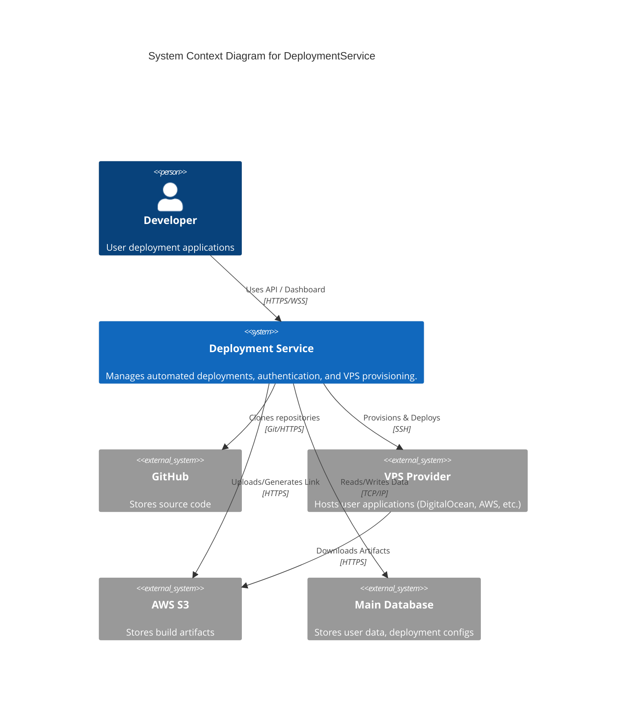
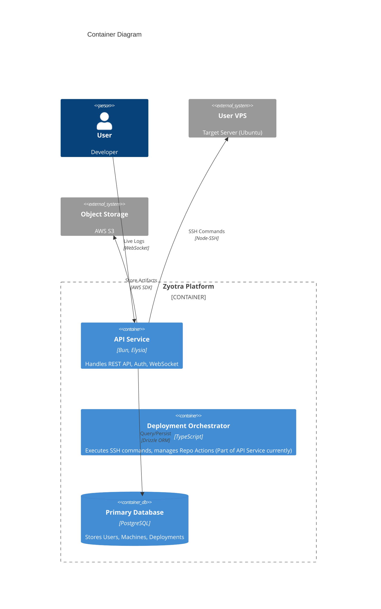
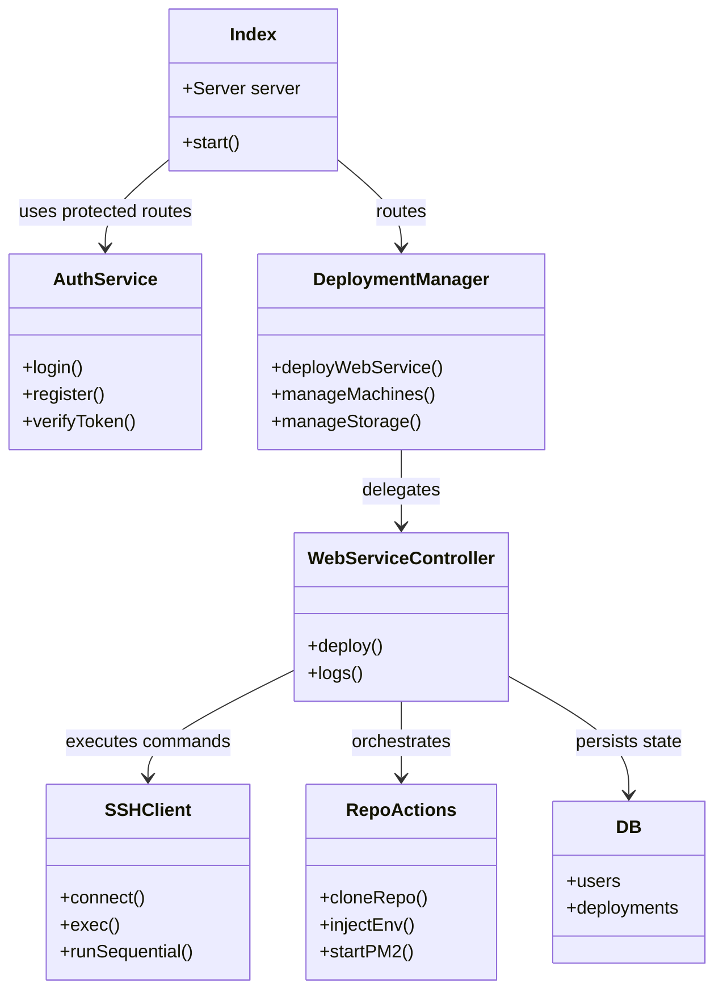
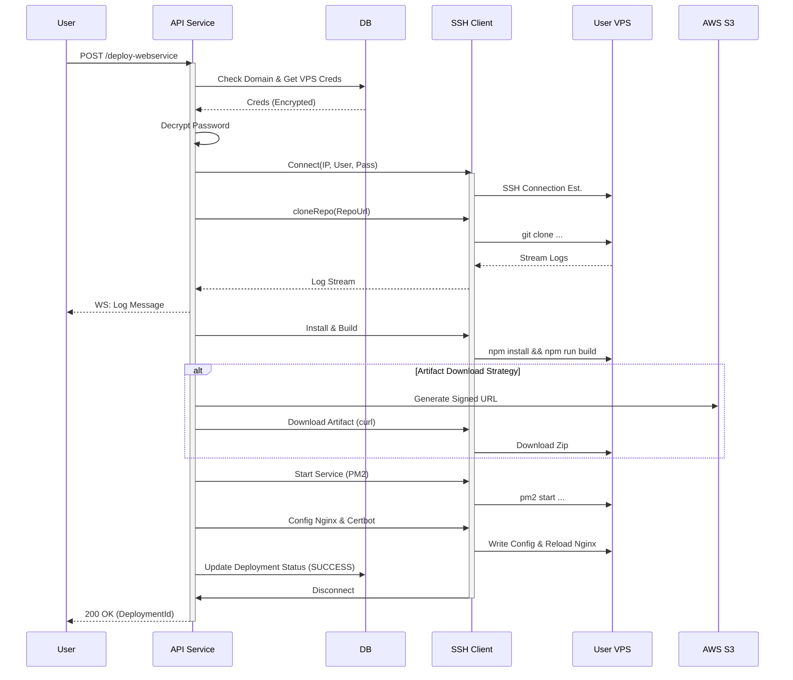

# Architecture Diagrams

## 1. System Context Diagram
Shows the DeploymentService in its environment.



## 2. Container Diagram
High-level containers of the system.



## 3. Component Diagram (Backend Service)
Detailed breakdown of the monolithic Backend Service.



## 4. Entity Relationship Diagram (ERD)

```mermaid
erDiagram
    USERS ||--o{ VPS_MACHINES : owns
    USERS ||--o{ DEPLOYMENTS : owns
    USERS ||--o{ ACTIVITY_LOGS : generates

    VPS_MACHINES ||--o{ DEPLOYMENTS : hosts
    
    USERS {
        int id PK
        string email
        string password_hash
    }

    VPS_MACHINES {
        uuid id PK
        int ownerId FK
        string ip
        string username
        string encrypted_password
    }

    DEPLOYMENTS {
        string id PK
        int ownerId FK
        uuid machineId FK
        string repoUrl
        string domain
        string status
    }
    
    ACTIVITY_LOGS {
        int id PK
        int param ownerId FK
        string action
        timestamp created_at
    }
```

## 5. Sequence Diagram: Deployment Flow
Critical path for `deploy-webservice`.



## 6. Logic Flow: Authentication

```mermaid
flowchart TD
    A[Client Request] --> B{Has Cookie?}
    B -- No --> C[401 Unauthorized]
    B -- Yes --> D[Extract Access Token]
    D --> E[Verify Token (JWT)]
    E -- Invalid --> C
    E -- Valid --> F[Attach userId to Context]
    F --> G[Execute Controller Logic]
```
